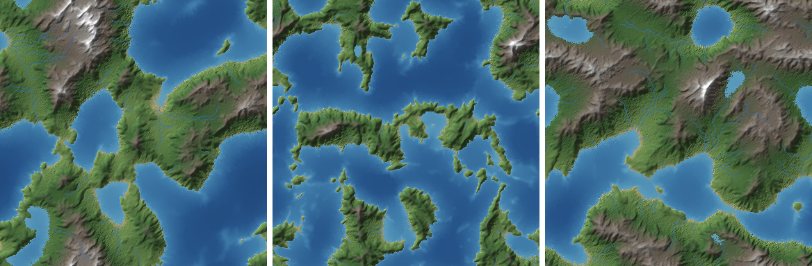

# terrasylva

Procedural world generation in Python: fractal noise, particle-based hydraulic
erosion, thermal erosion, lakes and rivers, climate and biomes, with exports for game
engines. Worlds are finite and can loop in both directions. A 1024×1024 terrain took about
3.7 s, or 4.3 s looping with an ocean (19.8 s at 2048×2048), on the development machine
(Numba-compiled kernels, after compilation). Adding climate and biomes to that looping
ocean world took 4.3 s to 5.7 s at 1024×1024, and 1.0 s to 1.4 s at 512×512.


*Left: raw noise and continents. Right: after thermal + hydraulic erosion and river
carving (512×512, seed 11, looping, 60% land).*

## Features

- **Looping worlds**: `wrap=True` makes noise, erosion, rivers, lakes and shading
  continue across all four edges.
- **Oceans and continents**: choose the land fraction and how broken up it is; rivers
  drain to the sea.
- **Climate**: temperature from a north-south band minus altitude, and rainfall from wind
  that carries moisture off the sea and lakes, so mountains get a wet side and a dry one.
  Rivers then follow the rain.
- **Biomes**: a configurable table (ocean, beach, desert, savanna, grassland, forest,
  rainforest, taiga, tundra, snow and rock by default) turned into a biome map, smooth
  per-biome weights and an RGBA splat map for ground textures.
- **Swappable steps**: remove, reorder, replace or re-run any stage, and save the whole
  setup as a JSON recipe.
- **Noise**: Perlin fBm, ridged multifractal, and domain warping. Deterministic per seed.
- **Hydraulic erosion**: droplet simulation with inertia, sediment capacity, brush-based
  erosion and deposition. Mass-conserving, with a border margin so edges stay intact.
- **Thermal erosion**: talus-angle slumping toward a stable angle of repose.
- **Hydrology**: priority-flood pit filling, lake mask and depth map, D8 flow routing
  through lakes, flow accumulation, river mask and valley carving.
- **Exports**: 16-bit PNG, 16-bit RAW (Unity/Unreal), tangent-space normal map,
  OBJ mesh with UVs and normals, water map, biome index map, splat map and biome legend,
  plus colour, hillshade, biome, temperature and rainfall previews.

## Install

```bash
git clone https://github.com/Antonetti-Lucas/terrasylva && cd terrasylva
pip install -e ".[dev]"
```

## Usage

CLI:

```bash
terrasylva generate --size 1024 --seed 42 --land 0.6 --wrap -o out/
terrasylva generate --size 512 --seed 5 --land 0.6 --wrap --biomes -o out/   # climate and biomes too
```

Python:

```python
import terrasylva as ts

t = ts.generate(512, seed=7)                 # noise -> thermal -> hydraulic -> rivers
ts.save_png16("height.png", t.heightmap)
ts.save_preview("preview.png", t.heightmap, t.rivers)

# or use the pieces directly
h = ts.fbm(512, seed=1, ridged=True, warp=0.4)
h = ts.hydraulic_erosion(h, drops=300_000, seed=1)
acc = ts.flow_accumulation(h)
lakes = ts.detect_lakes(h)                   # lakes.mask (bool), lakes.depth (float32)
rivers = ts.river_mask(acc, lakes=lakes.mask)
```

`generate()` also returns the lakes as `t.lakes` and `t.lake_depth`; pass
`lakes=t.lakes` to `save_preview` to draw them.

Heights are floats in `[0, 1]`. Erosion treats the full range as `relief` cell-units
(default `0.1 * size`), so slopes scale with resolution instead of getting steeper as
the map grows. Pass `relief=` to change how tall the terrain is relative to its width.

## Worlds, steps and recipes

```python
import terrasylva as ts

world = ts.World(size=1024, seed=42, cell_size=2.0, height_range=(0, 400), wrap=True)

def flatten_town(world):                     # any function can be a step
    h = world["height"].copy()
    h[500:540, 500:540] = h[520, 520]
    world["height"] = h

pipeline = ts.Pipeline([ts.Noise(), ts.Thermal(), ts.Hydraulic(), flatten_town, ts.Rivers()])
world = pipeline.run(world)

world["height"] = my_sculpted_heights        # edit, then recompute only the water
world = pipeline.run(world, start="rivers")
```

- `World` holds named layers plus real units: metres per cell and a height range.
- Each step's seed depends only on the world seed and the step's name, so removing a
  step doesn't change the randomness of the others.
- `Thermal(mask="name")` and `Hydraulic(mask="name")` only act where that layer is above
  0; everything else keeps its exact value. `Rivers(carve=False)` leaves heights alone.
- `save_recipe` / `load_recipe` store the settings and steps (not the layers). Custom
  steps need to be dataclasses. The CLI writes `recipe.json` next to its output, and
  `terrasylva run recipe.json -o out/` reproduces it.

## Looping worlds


*Seed 11 tiled 2×2, 60% land. Left: default, with visible seams. Right: `wrap=True`.*

A looping world has no border for water to leave by. Pass a bool `outlets` mask (or add an
`"ocean"` layer, which `Rivers` uses) to say where it drains; otherwise it drains to the
lowest cell. Looping needs a whole-number noise `scale`. The exported OBJ is a single
tile whose edges meet its neighbours exactly, so the game has to draw copies near the edge and move the player across.

## Oceans and continents


*Left to right: 60% land, an archipelago with 35% land, and 80% land (384×384, looping).*

```python
ts.Pipeline([ts.Noise(), ts.Continents(scale=2), ts.Thermal(), ts.Hydraulic(),
             ts.Ocean(land=0.6), ts.Rivers()])
```

`Continents` adds a low-frequency shape and fades mountains towards the sea floor; a higher
`scale` gives more, smaller land masses. `Ocean` picks the sea level that gives the
requested land fraction. Only open water (at least `min_area` of the map, or the largest
body) becomes ocean; smaller basins below sea level can become lakes. `Rivers` then drains
to the ocean and never carves land below the sea. Leave both steps out for a world with
no ocean.

`water.png` marks 85 = river, 170 = lake, 255 = ocean. In previews only real water is
blue: pass `ocean=`, `lakes=` and `sea_level=`.

## Climate and biomes


*Seed 99, 384×384, looping, 60% land. Left to right: biomes, temperature (blue cold, red
warm) and rainfall (sandy dry, blue wet). The default wind blows from the west.*

```python
world = ts.default_pipeline().run(ts.World(size=512, seed=5, wrap=True))
# Noise, Continents, Thermal, Hydraulic, Ocean, Climate, Rivers, Biomes
```

`Climate` goes after `Ocean` and before `Rivers`; `Biomes` goes after `Rivers`. Layers:

| Layer | Type | Meaning |
| --- | --- | --- |
| `temperature` | float32 | degrees C |
| `rainfall` | float32, >= 0 | mean 1 over land (everything outside `ocean`) |
| `moisture` | float32, [0, 1] | `rainfall / (rainfall + 1)` |
| `biome` | uint8 | index into the biome table |
| `biome_weights` | float32 `(size, size, N)` | sums to 1, smooth across borders |
| `splat` | uint8 `(size, size, 4)` | rock, grass, sand, snow; sums to exactly 255 |

**Temperature** runs from `cold_temp` to `warm_temp` along the north-south axis (one warm
band and one cold band when looping, cold at the top without `wrap`), bent by `wobble`,
and drops by `lapse` degrees (25 by default) between sea level and the highest point.
That is a drop across the whole height range, not 6.5 C/km, because these worlds are
compressed.

**Rainfall** comes from a steady-state moisture simulation, run on a grid of at most
`grid` (256) cells per side and interpolated back. Air blowing from `wind` degrees
(clockwise from north; 270 is a westerly) picks up moisture over the ocean and lakes, loses
it as ordinary rain (`rain_out`) and loses much more where it is forced uphill
(`orographic`), so the far side of a mountain is dry. `base` adds rain that needs no
moisture, `spread` mixes the air sideways so rain does not fall in ruler-straight stripes
along the wind, and `contrast` compresses the extremes. On a looping world every loss
step removes a fixed share of the moisture, so the simulation converges to one answer.
`Rivers` uses `rainfall` for `flow` when the layer exists, so dry regions get fewer rivers
and the rain is conserved along the drainage. Lakes are re-detected from the current
heights, never read from an earlier run.

```python
ts.Climate(wind=90.0, lapse=20.0)            # an easterly, a milder lapse
```

**Biomes** use a table of `Biome` rows. Each has a name, colour, optional `temperature`
(deg C), `moisture` (0 to 1), `slope` (degrees) and `height` (0 sea level, 1 highest,
negative below the sea) ranges as `(low, high)` with `None` for an open end, a `water`
flag for ocean biomes and a `splat` mix. The table is a list of rules in priority order: a
cell belongs to the first biome whose ranges contain it, edges are soft (`softness`), and a
cell no rule covers goes to the nearest biome, so an incomplete table still gives every cell
a biome. Seeded, looping noise (`noise`) nudges temperature and moisture before matching, and
rivers and lakes add up to `wet_bonus` moisture that fades over `wet_reach` of the map width.

```python
table = (
    ts.Biome("sea", (30, 70, 130), water=True, splat=(0, 0, 1, 0)),
    ts.Biome("ice", (240, 245, 250), temperature=(None, -5), splat=(0, 0, 0, 1)),
    ts.Biome("dunes", (230, 200, 120), moisture=(None, 0.3), splat=(0, 0, 1, 0)),
    ts.Biome("meadow", (120, 180, 90)),      # no ranges: takes everything left
)
ts.Biomes(table=table)
```

The table survives `save_recipe` / `load_recipe`. With `--biomes` the CLI also writes
`biomes.png` (indices), `splat.png` (RGBA), `biomes.json` (the legend: index, name, colour
and ranges) and `preview_biomes.png`, `preview_temperature.png` and `preview_rainfall.png`.
`terrasylva run` writes them whenever the layers exist. In Python, `colorize` takes
`biome=`, `biome_colors=` and optionally `biome_weights=`, and `colorize_layer` draws
temperature, rainfall or moisture.

If you change heights or the ocean afterwards, run `Climate` again, since `Rivers` and
`Biomes` read the layers it left behind. If you take `Climate` out of a pipeline, delete
the old `rainfall` layer too, or `Rivers` will keep using it.

## How the erosion works

Each droplet spawns at a random point and repeatedly: reads the bilinear height and
gradient, steers downhill (with inertia), and compares its sediment load to a capacity
proportional to slope, speed and water volume. Over capacity or moving uphill, it
deposits; under capacity, it erodes a radial brush of cells. When a droplet ends it
deposits whatever it still carries, so total height is conserved and the test suite
checks that. Without that step, eroded material vanishes and pits grow without bound.

## Lakes and flow routing


*Seed 42, 512×512, no ocean. Yellow: how water travels under the lakes to their outlets.*

A closed basin fills to the level at which it spills; lake depth is that level minus the
terrain. Basins that are too shallow or too small (`min_depth`, `min_area`) are not
marked as lakes. The flood grows up from the outlets (by default the border), always taking the lowest
reachable cell by *original* height. Each submerged cell drains to the cell it was
reached from, so flow follows the drowned valley floor to the outlet. Ties on exactly
flat ground are broken by a fixed hash rather than cell order, which is what used to
produce the stripes. Carving leaves lake beds untouched.

## Known limitations

- Square maps only, generated whole: no chunked or infinite generation.
- Erosion ignores the sea, so it also shapes the sea floor, and there are no beaches,
  waves or river deltas.
- Seas larger than `min_area` count as ocean even if enclosed by land.
- Steps after `Ocean` that change heights need `Ocean` to run again. With the default
  `land=`, that also recomputes the sea level; pass `level=` to keep it.
- Looping worlds without an ocean still drain to a single low point, so one basin looks dry.
- The same seed at a different size gives similar terrain but different lakes.
- Masked erosion is blended, so it doesn't conserve mass.
- Droplets are simulated sequentially (for determinism), so erosion doesn't scale
  across cores.
- Lakes always fill to their spill point: there is no evaporation or water balance.
  Without an ocean, terrain is lake-heavy (20-29% of the map on seeds 7, 11 and 42 at
  512×512); with one, lakes were 0-10% of the land on six test worlds.
- Without `wrap`, the map border is always an outlet, so a basin cut by the border never holds water,
  and a lake's extent can change if the map is cropped.
- Channels on dry flats wander plausibly but arbitrarily; D8 routing still limits flow to
  eight directions.
- Erosion parameters are tuned by eye on fBm terrain, not calibrated to real data.
- Climate is simple. There is one wind direction for the whole map, with no wind belts,
  seasons or monsoons, so a north-south coast facing the wind gets a long wet strip.
  Evaporation ignores temperature, and there are no ocean currents or coastal warming.
- Rainfall is simulated on at most 256×256 cells and interpolated, so rain does not
  resolve detail finer than `size / 256` cells. Without `wrap`, air is assumed to enter at
  the upwind edge with some moisture, which makes that edge wetter than it would be.
- `moisture` is a fixed squashing of `rainfall`, and the default biome ranges and
  temperatures were tuned by eye on six looping worlds with 60% land (seeds 5, 7, 11, 23, 42
  and 99). Biome shares varied from seed to seed: taiga was the largest at 13% to 26% of the
  land, and desert was 4% to 9%. Where the continents sit relative to the cold band decides
  a lot, so other seeds, land fractions or settings can still end up dominated by one biome.
- A beach is just low ground (up to 2% of the height above the sea), so wide flat coastal
  plains get wide beaches. Rock depends on slope, which depends on `height_range` and
  `cell_size`. Biome borders are soft and noisy, so they are not exact contours.
- `Rivers` carves the land after `Climate` has read it, so rainfall is computed from the
  uncarved heights. Rivers and lakes only change moisture by proximity, not rainfall.
- The default pipeline now includes `Climate`, so its rivers follow rainfall and differ
  from before; a pipeline without `Climate` gives exactly the old results.

## Roadmap

- [x] Explicit lake detection and flat-area river routing
- [x] World/pipeline core with recipes, units and independent seeds
- [x] Looping worlds
- [x] Oceans and continents, with rivers draining to the sea, and real water in previews
- [x] Climate (temperature, wind, rain shadows) and biome maps
- [ ] Wind that varies across the map, seasons, and evaporation that depends on temperature
- [ ] Visual editor (desktop, PySide6), so no code is needed: sliders, a 3D preview, steps to
  switch on, off or reorder, and buttons to save, load and export
- [ ] Godot import example
- [ ] Generic object placement (optional, works with your own assets)
- [ ] Cave networks with entrance masks (optional)
- [ ] Simple trees (optional)

## Tests

```bash
pytest
```

The suite covers determinism, looping, pipeline and recipe behaviour, mass conservation, border safety, flow conservation,
pit filling, acyclic routing, lake detection, and export formats. For climate and biomes it
checks shifted worlds against shifted results, colder air at altitude, rain shadows that
reverse with the wind, rain conserved along the drainage, weights and splat sums, custom and
incomplete biome tables, recipe round trips, worlds with no ocean, only ocean and flat
ground, and the CLI output files.

## License

MIT
