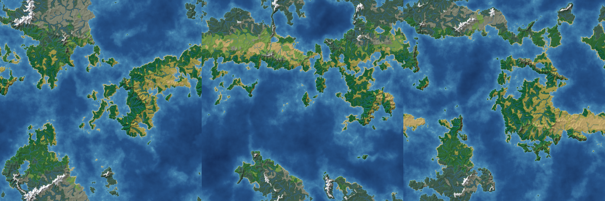
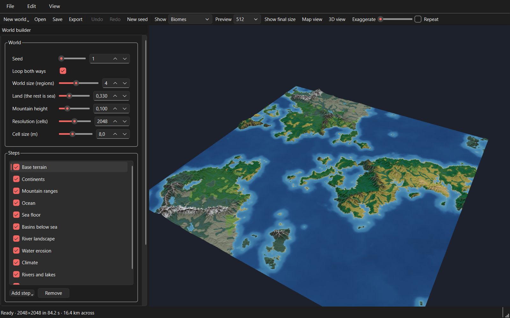
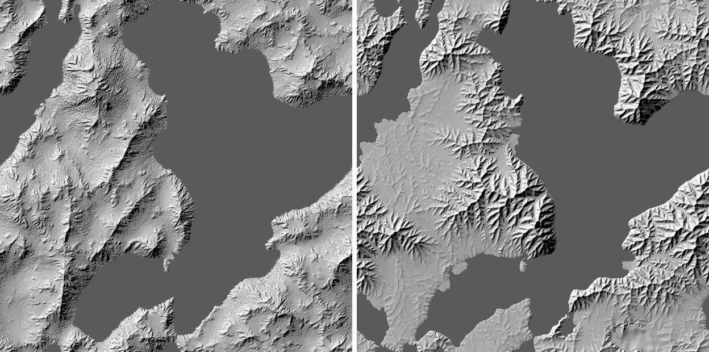
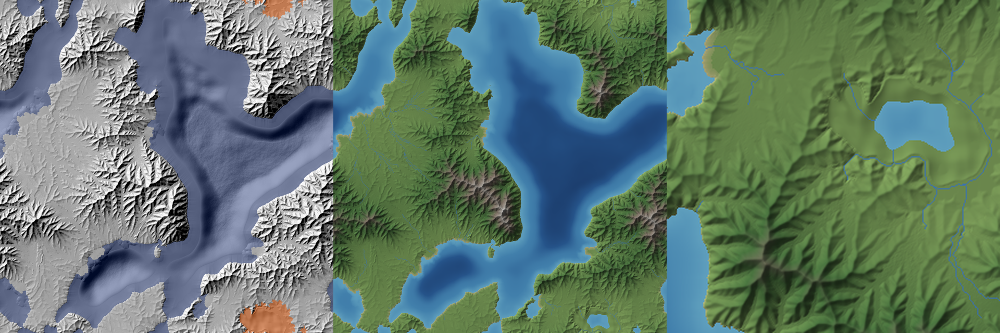
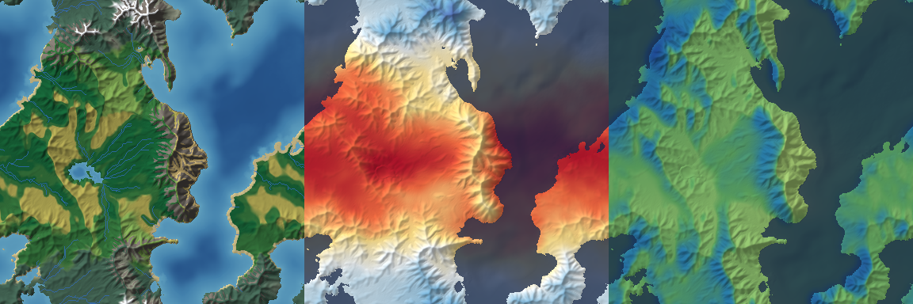

# terrasylva

[](https://github.com/Antonetti-Lucas/terrasylva/actions/workflows/tests.yml)

Procedural worlds in Python, from a command line, a desktop editor or your own code:
continents and oceans, mountain ranges carved by rivers, climate and biomes. Worlds are
finite, can loop in both directions, and export to files game engines can read.


*The editor's "World map" preset, seeds 1, 5 and 9, at 768×768.*

The project is young (0.1): no engine import has been tested yet, and the API may change.

## Features

- **Visual editor**: sliders, a 3D preview, presets and export, with no code.
- **River landscapes**: mountain ranges rise where plates collide while rivers carve them
  down, so valleys, ridges and drainage basins come out of one process.
- **Sediment**: plains, flat valley floors and deltas.
- **Oceans and continents**: choose the land fraction and how broken up it is. Sea floors
  have shelves and deep plains, and closed basins can lie below the sea.
- **Water**: lakes, rivers that reach the sea or end in an evaporating lake.
- **Climate**: temperature from a north-south band minus altitude, and rainfall from wind
  that carries moisture off the sea and lakes, so mountains get a wet side and a dry one.
- **Biomes**: a configurable table (ocean, beach, desert, savanna, grassland, forest,
  rainforest, taiga, tundra, snow and rock by default) turned into a biome map, smooth
  per-biome weights and an RGBA splat map for ground textures.
- **Looping worlds**: `wrap=True` makes everything continue across all four edges.
- **Swappable steps**: remove, reorder, replace or re-run any stage, and save the whole
  setup as a JSON recipe. Repeatable per seed on the same system; Windows and Linux
  differ (see [Known limitations](#known-limitations)).
- **Building blocks**: Perlin fBm, ridged noise and domain warping, droplet and thermal
  erosion, priority-flood filling, flow routing and accumulation, all usable on their own.
- **Exports**: 16-bit PNG, 16-bit RAW (Unity/Unreal), tangent-space normal map,
  OBJ mesh with UVs and normals, water map, biome index map, splat map and biome legend,
  plus colour, hillshade, biome, temperature and rainfall previews.

## Install

```bash
git clone https://github.com/Antonetti-Lucas/terrasylva && cd terrasylva
pip install -e ".[editor]"     # or just -e . without the editor, or ".[dev]" for the tests
```

## Visual editor



```bash
terrasylva editor            # or: terrasylva editor recipe.json
```

*New world* starts from a preset: world map, continent, archipelago or region. *World size*
puts more regions on the map; *Resolution* only adds detail; *Land* sets how much is sea.
Move the sliders and the preview updates. Tick, untick, drag, add or remove steps; only
the steps after a change run again. *Show* switches between landscape, biomes,
temperature, rainfall and height, and *Repeat* draws copies around a looping world.
*Export* generates at the final size and writes the same files as the command line. Saved
recipes also run with `terrasylva run`. Drag to orbit, right-drag to move, scroll to zoom.

Editor limits: no sculpting brush, and biome tables are edited in recipes or Python. The
preview is smaller than the final world, so lakes and small rivers differ;
use *Show final size* to check. A running step finishes before a change takes effect.

## Usage

CLI:

```bash
terrasylva generate --size 1024 --seed 42 --fluvial --biomes --wrap -o out/   # everything
terrasylva generate --size 2048 --extent 4 --land 0.33 --fluvial --biomes --wrap -o out/
terrasylva generate --size 1024 --seed 42 --land 0.6 --wrap -o out/          # classic, faster
```

Python:

```python
import terrasylva as ts

world = ts.default_pipeline().run(ts.World(size=512, seed=7, wrap=True))
heights = world["height"]                    # float32; also ocean, rivers, biome, ...

t = ts.generate(512, seed=7)                 # classic: noise -> thermal -> hydraulic -> rivers
ts.save_png16("height.png", t.heightmap)
ts.save_preview("preview.png", t.heightmap, t.rivers)

# or use the pieces directly
h = ts.fbm(512, seed=1, ridged=True, warp=0.4)
h = ts.hydraulic_erosion(h, drops=300_000, seed=1)
acc = ts.flow_accumulation(h)
lakes = ts.detect_lakes(h)                   # lakes.mask (bool), lakes.depth (float32)
rivers = ts.river_mask(acc, lakes=lakes.mask)
```

`generate()` also returns the lakes as `t.lakes` and `t.lake_depth`; pass
`lakes=t.lakes` to `save_preview` to draw them.

Heights are floats in `[0, 1]`. Erosion treats the full range as `relief` cell-units
(default `0.1 * size`), so slopes scale with resolution instead of getting steeper as
the map grows. Pass `relief=` to change how tall the terrain is relative to its width.

## Worlds, steps and recipes

```python
import terrasylva as ts

world = ts.World(size=1024, seed=42, cell_size=2.0, height_range=(0, 400), wrap=True)

def flatten_town(world):                     # any function can be a step
    h = world["height"].copy()
    h[500:540, 500:540] = h[520, 520]
    world["height"] = h

pipeline = ts.Pipeline([ts.Noise(), ts.Thermal(), ts.Hydraulic(), flatten_town, ts.Rivers()])
world = pipeline.run(world)

world["height"] = my_sculpted_heights        # edit, then recompute only the water
world = pipeline.run(world, start="rivers")
```

- `World` holds named layers plus real units: metres per cell and a height range.
- Each step's seed depends only on the world seed and the step's name, so removing a
  step doesn't change the randomness of the others.
- `Thermal(mask="name")` and `Hydraulic(mask="name")` only act where that layer is above
  0; everything else keeps its exact value. `Rivers(carve=False)` leaves heights alone.
- `save_recipe` / `load_recipe` store the settings and steps (not the layers). Custom
  steps need to be dataclasses. The CLI writes `recipe.json` next to its output, and
  `terrasylva run recipe.json -o out/` reproduces it on the same system.

## World size

`World(extent=4)` holds 4×4 regions' worth of ranges, valleys, coasts and weather; `size` is
only the number of cells. Raise both to keep the detail, e.g. `size=2048, extent=4`. Mountains
keep their proportions, so a large world is flatter relative to its width (the editor draws
it steeper). `Continents(scale=...)` still counts land masses across the whole world.

## Looping worlds


*Classic terrain, seed 11 tiled 2×2, 60% land. Left: default, with visible seams. Right: `wrap=True`.*

A looping world has no border for water to leave by. Pass a bool `outlets` mask (or add an
`"ocean"` layer, which `Rivers` uses) to say where it drains; otherwise it drains to the
lowest cell. Looping needs a whole-number noise `scale`. The exported OBJ is a single
tile whose edges meet its neighbours exactly, so the game has to draw copies near the edge and move the player across.

## River landscapes


*Seed 42, 1024×1024, shading only. Left: `classic_pipeline()`. Right: `default_pipeline()`.*

`Ranges` places converging plates and writes how fast the ground rises. `Fluvial` then
solves the stream-power law `dh/dt = U - K A^m S` with hillslope creep, from a coarse grid
to the full one, with rock hardness that varies. Run `Ocean` before it: rivers end at that
coast. A light `Hydraulic(capacity=0.5)` adds fine detail. `terrasylva generate --fluvial`
does the same from the command line. `classic_pipeline()` and `generate()` keep the faster
method, in which erosion touches up noise and rivers are carved in afterwards.

Compared with real elevation data (five 1024×1024 areas at 53-74 m per cell: Alps, Andes,
Appalachians, Himalaya and Pyrenees, from the
[Terrain Tiles](https://registry.opendata.aws/terrain-tiles/) dataset), with the same code on
both. Generated values are means of seeds 3, 8 and 15. Most settings were tuned on other
seeds, but the strength of the valley floors was chosen with these, so they aren't a fully
independent check:

| | Classic | Default | Real (min to max) |
|---|---|---|---|
| River profile concavity | 0.13 | 0.31 | 0.22 to 0.30 |
| Hack exponent (basin shape) | 0.45 | 0.46 | 0.49 to 0.57 |
| Median slope | 18.9° | 21.3° | 10.2° to 27.7° |
| Steepest 1% of slopes | 55.6° | 49.1° | 31.9° to 56.4° |
| Relief in 64 vs 16 cells | 3.37 | 2.63 | 2.40 to 2.77 |
| Hypsometric integral (128 cells) | 0.49 | 0.38 | 0.38 to 0.50 |
| Curvature skew (sharp ridges < 0) | -1.31 | 0.31 | -0.42 to 0.00 |
| Roughness (curvature / slope) | 3.77 | 1.00 | 0.79 to 2.01 |
| Spectral slope, coarse (6-40 cycles) | -3.18 | -2.99 | -3.42 to -3.18 |
| Spectral slope, fine (40-250 cycles) | -2.86 | -3.28 | -5.14 to -3.58 |
| Land in closed basins | 5.2% | 3.4% | 0.7% to 2.6% |

Over twelve such measures the average distance outside the real range, in range widths, is
0.72 for classic and 0.21 for the default. Six of the twelve fall inside it (classic: four),
so this is closer, not there yet. Five mountain areas are a small sample, and the generated
maps also contain plains and coasts. Closed basins include the deliberate ones.

It costs time: 2.1, 6.8, 19.1 and 68.5 s at 256, 512, 1024 and 2048, against 0.5, 1.5, 6.5
and 27.7 s for the classic pipeline (single runs, climate and biomes included).

## Sediment, sea floors and land below the sea


*Seed 42, 1024×1024. Left: relief, with land below sea level in orange and the sea in blue.
Middle: the same map. Right: a closed basin, with rivers ending in its lake.*

- **Plains and valley floors**: `Fluvial(deposition=)` lets debris from fast-rising mountains
  build up the land below them, and `valleys=` fills valley bottoms, wider downstream.
- **Deltas**: `deltas=` extends the coast at the mouths of large rivers, updating `ocean`.
- **Sea floor**: `SeaFloor` makes a shallow shelf, a slope and an abyssal plain.
- **Land below the sea**: `Basins` places closed depressions far inland, as deep as `depth`
  below sea level. `Fluvial` drains the land around them inwards and writes `sinks`, where
  rivers end. `Rivers` gives each a lake that evaporates as much as flows in
  (`evaporation=`), so part of the basin usually stays dry.

Valley floors and deltas are shaped, not simulated, so they don't conserve mass.

## Oceans and continents


*Classic terrain. Left to right: 60% land, an archipelago with 35% land, and 80% land (384×384, looping).*

```python
ts.Pipeline([ts.Noise(), ts.Continents(scale=2), ts.Thermal(), ts.Hydraulic(),
             ts.Ocean(land=0.6), ts.Rivers()])
```

`Continents` adds a low-frequency shape and fades mountains towards the sea floor; a higher
`scale` gives more, smaller land masses. `Ocean` picks the sea level that gives the
requested land fraction. Only open water (at least `min_area` of a region, or the largest
body) becomes ocean; smaller basins below sea level can become lakes. `Rivers` then drains
to the ocean and never carves land below the sea. Leave both steps out for a world with
no ocean.

`water.png` marks 85 = river, 170 = lake, 255 = ocean. In previews only real water is
blue: pass `ocean=`, `lakes=` and `sea_level=`.

## Climate and biomes


*Seed 99, 384×384, looping, 60% land. Left to right: biomes, temperature (blue cold, red
warm) and rainfall (sandy dry, blue wet). The default wind blows from the west.*

```python
world = ts.default_pipeline().run(ts.World(size=512, seed=5, wrap=True))
# Noise, Continents, Ranges, Ocean, SeaFloor, Basins, Fluvial, Hydraulic, Climate, Rivers, Biomes
```

`Climate` goes after `Ocean` and before `Rivers`; `Biomes` goes after `Rivers`. Layers:

| Layer | Type | Meaning |
| --- | --- | --- |
| `temperature` | float32 | degrees C |
| `rainfall` | float32, >= 0 | mean 1 over land (everything outside `ocean`) |
| `moisture` | float32, [0, 1] | `rainfall / (rainfall + 1)` |
| `biome` | uint8 | index into the biome table |
| `biome_weights` | float32 `(size, size, N)` | sums to 1, smooth across borders |
| `splat` | uint8 `(size, size, 4)` | rock, grass, sand, snow; sums to exactly 255 |

**Temperature** runs from `cold_temp` to `warm_temp` along the north-south axis (one warm
band and one cold band when looping, cold at the top without `wrap`), bent by `wobble`,
and drops by `lapse` degrees (25 by default) between sea level and the highest point.
That is a drop across the whole height range, not 6.5 C/km, because these worlds are
compressed.

**Rainfall** comes from a steady-state moisture simulation, run on a grid of at most
`grid` (256) cells per side and interpolated back. Air blowing from `wind` degrees
(clockwise from north; 270 is a westerly) picks up moisture over the ocean and lakes, loses
it as ordinary rain (`rain_out`) and loses much more where it is forced uphill
(`orographic`), so the far side of a mountain is dry. `base` adds rain that needs no
moisture, `spread` mixes the air sideways so rain does not fall in ruler-straight stripes
along the wind, and `contrast` compresses the extremes. On a looping world every loss
step removes a fixed share of the moisture, so the simulation converges to one answer.
`Rivers` uses `rainfall` for `flow` when the layer exists, so dry regions get fewer rivers
and the rain is conserved along the drainage. Lakes are re-detected from the current
heights, never read from an earlier run.

```python
ts.Climate(wind=90.0, lapse=20.0)            # an easterly, a milder lapse
```

**Biomes** use a table of `Biome` rows. Each has a name, colour, optional `temperature`
(deg C), `moisture` (0 to 1), `slope` (degrees), `height` (0 sea level, 1 highest,
negative below the sea) and `shore` (distance to the sea) ranges as `(low, high)` with `None` for an open end, a `water`
flag for ocean biomes and a `splat` mix. The table is a list of rules in priority order: a
cell belongs to the first biome whose ranges contain it, edges are soft (`softness`), and a
cell no rule covers goes to the nearest biome, so an incomplete table still gives every cell
a biome. Seeded, looping noise (`noise`) nudges temperature and moisture before matching, and
rivers and lakes add up to `wet_bonus` moisture that fades over `wet_reach` of a region's width.

```python
table = (
    ts.Biome("sea", (30, 70, 130), water=True, splat=(0, 0, 1, 0)),
    ts.Biome("ice", (240, 245, 250), temperature=(None, -5), splat=(0, 0, 0, 1)),
    ts.Biome("dunes", (230, 200, 120), moisture=(None, 0.3), splat=(0, 0, 1, 0)),
    ts.Biome("meadow", (120, 180, 90)),      # no ranges: takes everything left
)
ts.Biomes(table=table)
```

The table survives `save_recipe` / `load_recipe`. With `--biomes` the CLI also writes
`biomes.png` (indices), `splat.png` (RGBA), `biomes.json` (the legend: index, name, colour
and ranges) and `preview_biomes.png`, `preview_temperature.png` and `preview_rainfall.png`.
`terrasylva run` writes them whenever the layers exist. In Python, `colorize` takes
`biome=`, `biome_colors=` and optionally `biome_weights=`, and `colorize_layer` draws
temperature, rainfall or moisture.

If you change heights or the ocean afterwards, run `Climate` again, since `Rivers` and
`Biomes` read the layers it left behind. If you take `Climate` out of a pipeline, delete
the old `rainfall` layer too, or `Rivers` will keep using it.

## How droplet erosion works


*Classic terrain, 512×512, seed 11, looping. Left: raw noise and continents. Right: after
thermal and droplet erosion and river carving.*

Each droplet spawns at a random point and repeatedly: reads the bilinear height and
gradient, steers downhill (with inertia), and compares its sediment load to a capacity
proportional to slope, speed and water volume. Over capacity or moving uphill, it
deposits; under capacity, it erodes a radial brush of cells. When a droplet ends it
deposits whatever it still carries, so total height is conserved and the test suite
checks that. Without that step, eroded material vanishes and pits grow without bound.

## Lakes and flow routing


*Seed 42, 512×512, no ocean. Yellow: how water travels under the lakes to their outlets.*

A closed basin fills to the level at which it spills; lake depth is that level minus the
terrain. Basins that are too shallow or too small (`min_depth`, `min_area`) are not
marked as lakes. The flood grows up from the outlets (by default the border), always taking the lowest
reachable cell by *original* height. Each submerged cell drains to the cell it was
reached from, so flow follows the drowned valley floor to the outlet. Ties on exactly
flat ground are broken by a fixed hash rather than cell order, which is what used to
produce the stripes. Carving leaves lake beds untouched.

## Known limitations

- Square maps only, generated whole: no chunked or infinite generation.
- Erosion before `Ocean` also shapes the sea floor; after it, the coast and sea floor are
  fixed and eroded material that reaches the sea is lost. There are no
  glaciers, volcanoes, tides or layered rock.
- Lakes are rare outside closed basins, because rivers have had time to drain them. Basin
  lakes look jagged on coarse maps of large worlds. Real ranges still have larger valleys,
  and folds that give them a direction. Coasts are smoother than real ones, plains are
  still finely dissected, and plates only place ranges: they don't move.
- `Fluvial` ignores the `rainfall` layer, since climate is computed from the finished land.
- Seas larger than `min_area` count as ocean even if enclosed by land.
- Steps after `Ocean` that change heights need `Ocean` to run again. With the default
  `land=`, that also recomputes the sea level; pass `level=` to keep it.
- Looping worlds without an ocean still drain to a single low point, so one basin looks dry.
- The same seed at a different size gives similar terrain but different lakes.
- The same seed and settings give the same world on the same computer with the same
  versions of terrasylva, NumPy and Numba, but Windows and Linux don't match. Some 32-bit
  maths rounds differently, by about 1e-7, and erosion and rivers amplify it. Between
  Windows and Ubuntu on one PC (256×256, two seeds, with and without `wrap`), heights
  (0 to 1) differed by up to 0.034 with the default pipeline and 0.22 with the classic one,
  and up to 1.3% and 7.2% of cells changed biome. A recipe therefore doesn't reproduce a
  world exactly on another system. On each of the two, 64×64 worlds were identical across
  the Intel and AMD processors tried. macOS, ARM and future library versions haven't been
  compared.
- Masked erosion is blended, so it doesn't conserve mass.
- Droplets are simulated sequentially (for determinism), so erosion doesn't scale
  across cores.
- Lakes outside closed basins fill to their spill point, without a water balance.
  Classic terrain without an ocean is lake-heavy (20-29% of the map on seeds 7, 11 and 42 at
  512×512); with one, lakes were 0-10% of the land on six test worlds.
- Large worlds are slow: the 2048×2048 world map took 81 s in the editor.
- Without `wrap`, the map border is always an outlet, so a basin cut by the border never holds water,
  and a lake's extent can change if the map is cropped.
- Channels on dry flats wander plausibly but arbitrarily; D8 routing still limits flow to
  eight directions.
- Droplet erosion is tuned by eye. Only the river landscape was compared with real data.
- Files for Unity, Unreal and Godot are written but no import has been tested.
- Climate is simple. There is one wind direction for the whole map, with no wind belts,
  seasons or monsoons, so a north-south coast facing the wind gets a long wet strip.
  Evaporation ignores temperature, and there are no ocean currents or coastal warming.
- Rainfall is simulated on at most 256×256 cells and interpolated, so rain does not
  resolve detail finer than `size / 256` cells. Without `wrap`, air is assumed to enter at
  the upwind edge with some moisture, which makes that edge wetter than it would be.
- `moisture` is a fixed squashing of `rainfall`, and the default biome ranges were tuned by
  eye on classic worlds. Shares vary a lot by seed: on one region (seed 42) there is no desert
  or snow and 17% of the land is bare rock.
- Beaches are low ground close to the sea, at least two cells wide, so they look broad on
  coarse maps. Rock depends on slope, which depends on `height_range` and `cell_size`. Biome
  borders are soft and noisy, not exact contours.
- Unless `carve=False`, `Rivers` carves the land after `Climate` has read it, so rainfall is computed from the
  uncarved heights. Rivers and lakes only change moisture by proximity, not rainfall.

## Roadmap

- [x] Explicit lake detection and flat-area river routing
- [x] World/pipeline core with recipes, units and independent seeds
- [x] Looping worlds
- [x] Oceans and continents, with rivers draining to the sea, and real water in previews
- [x] Plate-driven ranges and river-carved landscapes
- [x] Sediment, deltas, sea floors and closed basins below the sea
- [ ] Layered rock and folds, glaciers
- [x] Climate (temperature, wind, rain shadows) and biome maps
- [ ] Wind that varies across the map, seasons, and evaporation that depends on temperature
- [x] Visual editor (desktop, PySide6): sliders, 3D preview, step list, save, load, export
- [ ] Documented file formats and a minimal Godot import example
- [ ] Basic object placement (points for your own assets)
- [x] Automatic tests on Windows and Linux
- [ ] Faster generation

This package makes one complete map at a time, and that stays free under the MIT license.
Work on walkable open worlds and hand editing happens in a separate project.

## Tests

```bash
pytest
```

The suite covers determinism, looping, pipelines and recipes, the editor, river landscapes,
sediment, mass conservation, border safety, flow conservation, pit filling, acyclic routing, lake detection, and export formats. For climate and biomes it
checks shifted worlds against shifted results, colder air at altitude, rain shadows that
reverse with the wind, rain conserved along the drainage, weights and splat sums, custom and
incomplete biome tables, recipe round trips, worlds with no ocean, only ocean and flat
ground, and the CLI output files.

On Windows, two 64×64 worlds are also compared with stored hashes, so that a change to
the output doesn't go unnoticed. After an intended change, or a NumPy or Numba update
that changes them, `python tests/test_layer_hashes.py` prints the new ones.

## License

MIT
