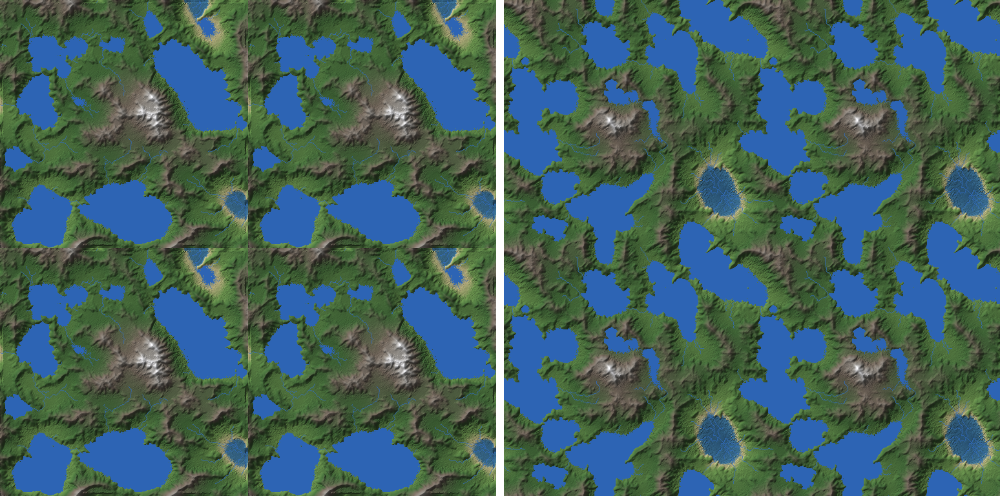
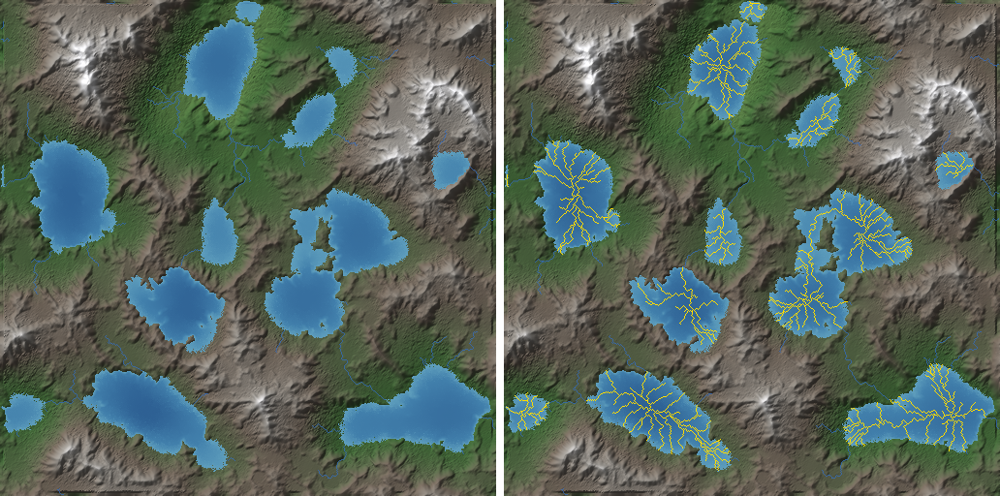

# terrasylva

Procedural world generation in Python: fractal noise, particle-based hydraulic
erosion, thermal erosion, lakes and rivers, with exports for game engines. Worlds are
finite and can loop in both directions. A 1024×1024 terrain took about 3.6 s, or 4.4 s
looping, on the development machine (Numba-compiled kernels, after compilation).


*Left: raw domain-warped fBm. Right: after thermal + hydraulic erosion and river
carving (512×512, seed 11).*

## Features

- **Looping worlds**: `wrap=True` makes noise, erosion, rivers, lakes and shading
  continue across all four edges.
- **Swappable steps**: remove, reorder, replace or re-run any stage, and save the whole
  setup as a JSON recipe.
- **Noise**: Perlin fBm, ridged multifractal, and domain warping. Deterministic per seed.
- **Hydraulic erosion**: droplet simulation with inertia, sediment capacity, brush-based
  erosion and deposition. Mass-conserving, with a border margin so edges stay intact.
- **Thermal erosion**: talus-angle slumping toward a stable angle of repose.
- **Hydrology**: priority-flood pit filling, lake mask and depth map, D8 flow routing
  through lakes, flow accumulation, river mask and valley carving.
- **Exports**: 16-bit PNG, 16-bit RAW (Unity/Unreal), tangent-space normal map,
  OBJ mesh with UVs and normals, plus colour and hillshade previews.

## Install

```bash
git clone https://github.com/Antonetti-Lucas/terrasylva && cd terrasylva
pip install -e ".[dev]"
```

## Usage

CLI:

```bash
terrasylva generate --size 1024 --seed 42 --drops 400000 -o out/
```

Python:

```python
import terrasylva as ts

t = ts.generate(512, seed=7)                 # noise -> thermal -> hydraulic -> rivers
ts.save_png16("height.png", t.heightmap)
ts.save_preview("preview.png", t.heightmap, t.rivers)

# or use the pieces directly
h = ts.fbm(512, seed=1, ridged=True, warp=0.4)
h = ts.hydraulic_erosion(h, drops=300_000, seed=1)
acc = ts.flow_accumulation(h)
lakes = ts.detect_lakes(h)                   # lakes.mask (bool), lakes.depth (float32)
rivers = ts.river_mask(acc, lakes=lakes.mask)
```

`generate()` also returns the lakes as `t.lakes` and `t.lake_depth`; pass
`lakes=t.lakes` to `save_preview` to draw them.

Heights are floats in `[0, 1]`. Erosion treats the full range as `relief` cell-units
(default `0.1 * size`), so slopes scale with resolution instead of getting steeper as
the map grows. Pass `relief=` to change how tall the terrain is relative to its width.

## Worlds, steps and recipes

```python
import terrasylva as ts

world = ts.World(size=1024, seed=42, cell_size=2.0, height_range=(0, 400), wrap=True)

def flatten_town(world):                     # any function can be a step
    h = world["height"].copy()
    h[500:540, 500:540] = h[520, 520]
    world["height"] = h

pipeline = ts.Pipeline([ts.Noise(), ts.Thermal(), ts.Hydraulic(), flatten_town, ts.Rivers()])
world = pipeline.run(world)

world["height"] = my_sculpted_heights        # edit, then recompute only the water
world = pipeline.run(world, start="rivers")
```

- `World` holds named layers plus real units: metres per cell and a height range.
- Each step's seed depends only on the world seed and the step's name, so removing a
  step doesn't change the randomness of the others.
- `Thermal(mask="name")` and `Hydraulic(mask="name")` only act where that layer is above
  0; everything else keeps its exact value. `Rivers(carve=False)` leaves heights alone.
- `save_recipe` / `load_recipe` store the settings and steps (not the layers). Custom
  steps need to be dataclasses. The CLI writes `recipe.json` next to its output, and
  `terrasylva run recipe.json -o out/` reproduces it.

## Looping worlds


*Seed 11 tiled 2×2. Left: default, with visible seams. Right: `wrap=True`.*

A looping world has no border for water to leave by. Pass a bool `outlets` mask (or add an
`"ocean"` layer, which `Rivers` uses) to say where it drains; otherwise it drains to the
lowest cell. Looping needs a whole-number noise `scale`. The exported OBJ is a single
tile, so the game has to draw copies near the edge and move the player across.

## How the erosion works

Each droplet spawns at a random point and repeatedly: reads the bilinear height and
gradient, steers downhill (with inertia), and compares its sediment load to a capacity
proportional to slope, speed and water volume. Over capacity or moving uphill, it
deposits; under capacity, it erodes a radial brush of cells. When a droplet ends it
deposits whatever it still carries, so total height is conserved and the test suite
checks that. Without that step, eroded material vanishes and pits grow without bound.

## Lakes and flow routing


*Seed 42, 512×512. Left: the previous routing, with straight parallel rivers across
filled basins. Right: basins become lakes and rivers stop at the shore.*

A closed basin fills to the level at which it spills; lake depth is that level minus the
terrain. Basins that are too shallow or too small (`min_depth`, `min_area`) are not
marked as lakes. The flood grows up from the outlets (by default the border), always taking the lowest
reachable cell by *original* height. Each submerged cell drains to the cell it was
reached from, so flow follows the drowned valley floor to the outlet. Ties on exactly
flat ground are broken by a fixed hash rather than cell order, which is what used to
produce the stripes. Carving leaves lake beds untouched.

## Known limitations

- Square maps only, generated whole: no chunked or infinite generation.
- The OBJ leaves a one-cell gap between neighbouring looped tiles, and it is
  block-averaged; use the heightmap for exact edges.
- Looping worlds without an ocean drain to a single low point, so one basin looks dry.
- The same seed at a different size gives similar terrain but different lakes.
- Masked erosion is blended, so it doesn't conserve mass.
- Droplets are simulated sequentially (for determinism), so erosion doesn't scale
  across cores.
- Lakes always fill to their spill point: there is no evaporation or water balance, so
  default terrain is lake-heavy (23-26% of the map on seeds 7, 11 and 42 at 512×512).
- Without `wrap`, the map border is always an outlet, so a basin cut by the border never holds water,
  and a lake's extent can change if the map is cropped.
- Channels on dry flats wander plausibly but arbitrarily; D8 routing still limits flow to
  eight directions.
- The preview draws detected lakes in flat blue, but still also colours low elevation
  blue, whether or not it holds water.
- Erosion parameters are tuned by eye on fBm terrain, not calibrated to real data.

## Roadmap

- [x] Explicit lake detection and flat-area river routing
- [x] World/pipeline core with recipes, units and independent seeds
- [x] Looping worlds
- [ ] Oceans and continents, with rivers draining to the sea, and real water in previews
- [ ] Climate (temperature, wind, rain shadows) and biome maps
- [ ] Browser viewer (Three.js) and a Godot import example
- [ ] Generic object placement (optional, works with your own assets)
- [ ] Cave networks with entrance masks (optional)
- [ ] Simple trees (optional)

## Tests

```bash
pytest
```

The suite covers determinism, looping, pipeline and recipe behaviour, mass conservation, border safety, flow conservation,
pit filling, acyclic routing, lake detection, and export formats.

## License

MIT
