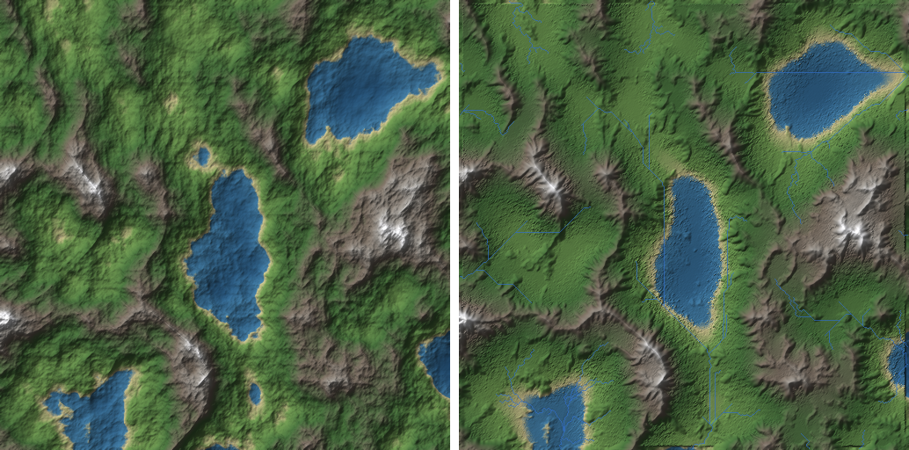

# terrainforge

Procedural terrain generation in Python: fractal noise, particle-based hydraulic
erosion, thermal erosion, and river extraction, with exports for game engines.
It generates a 1024×1024 eroded terrain in about 3.5 s on 2 CPU cores
(Numba-compiled kernels).


*Left: raw domain-warped fBm. Right: after thermal + hydraulic erosion and river
carving (512×512, seed 11).*

## Features

- **Noise**: Perlin fBm, ridged multifractal, and domain warping. Deterministic per seed.
- **Hydraulic erosion**: droplet simulation with inertia, sediment capacity, brush-based
  erosion and deposition. Mass-conserving, with a border margin so edges stay intact.
- **Thermal erosion**: talus-angle slumping toward a stable angle of repose.
- **Hydrology**: priority-flood pit filling, lake mask and depth map, D8 flow routing
  through lakes, flow accumulation, river mask and valley carving.
- **Exports**: 16-bit PNG, 16-bit RAW (Unity/Unreal), tangent-space normal map,
  OBJ mesh with UVs and normals, plus colour and hillshade previews.

## Install

```bash
git clone https://github.com/Antonetti-Lucas/terrainforge && cd terrainforge
pip install -e ".[dev]"
```

## Usage

CLI:

```bash
terrainforge generate --size 1024 --seed 42 --drops 400000 -o out/
```

Python:

```python
import terrainforge as tf

t = tf.generate(512, seed=7)                 # noise -> thermal -> hydraulic -> rivers
tf.save_png16("height.png", t.heightmap)
tf.save_preview("preview.png", t.heightmap, t.rivers)

# or use the pieces directly
h = tf.fbm(512, seed=1, ridged=True, warp=0.4)
h = tf.hydraulic_erosion(h, drops=300_000, seed=1)
acc = tf.flow_accumulation(h)
lakes = tf.detect_lakes(h)                   # lakes.mask (bool), lakes.depth (float32)
rivers = tf.river_mask(acc, lakes=lakes.mask)
```

`generate()` also returns the lakes as `t.lakes` and `t.lake_depth`; pass
`lakes=t.lakes` to `save_preview` to draw them.

Heights are floats in `[0, 1]`. Erosion treats the full range as `relief` cell-units
(default `0.1 * size`), so slopes scale with resolution instead of getting steeper as
the map grows. Pass `relief=` to change how tall the terrain is relative to its width.

## How the erosion works

Each droplet spawns at a random point and repeatedly: reads the bilinear height and
gradient, steers downhill (with inertia), and compares its sediment load to a capacity
proportional to slope, speed and water volume. Over capacity or moving uphill, it
deposits; under capacity, it erodes a radial brush of cells. When a droplet ends it
deposits whatever it still carries, so total height is conserved and the test suite
checks that. Without that step, eroded material vanishes and pits grow without bound.

## Lakes and flow routing


*Seed 42, 512×512. Left: the previous routing, with straight parallel rivers across
filled basins. Right: basins become lakes and rivers stop at the shore.*

A closed basin fills to the level at which it spills; lake depth is that level minus the
terrain. Basins that are too shallow or too small (`min_depth`, `min_area`) are not
marked as lakes. The flood grows inwards from the border, always taking the lowest
reachable cell by *original* height. Each submerged cell drains to the cell it was
reached from, so flow follows the drowned valley floor to the outlet. Ties on exactly
flat ground are broken by a fixed hash rather than cell order, which is what used to
produce the stripes. Carving leaves lake beds untouched.

## Known limitations

- Square maps only; no tiling or chunked generation across seams yet.
- Droplets are simulated sequentially (for determinism), so erosion doesn't scale
  across cores.
- Lakes always fill to their spill point: there is no evaporation or water balance, so
  default terrain is lake-heavy (23-26% of the map on seeds 7, 11 and 42 at 512×512).
- The map border is always an outlet, so a basin cut by the border never holds water,
  and a lake's extent can change if the map is cropped.
- Channels on dry flats wander plausibly but arbitrarily; D8 routing still limits flow to
  eight directions.
- The preview draws detected lakes in flat blue, but still also colours low elevation
  blue, whether or not it holds water.
- Erosion parameters are tuned by eye on fBm terrain, not calibrated to real data.

## Roadmap

- [x] Explicit lake detection and flat-area river routing
- [ ] Real water in previews (sea level parameter, lakes only where water stands)
- [ ] Tileable generation with erosion across chunk borders
- [ ] GPU (compute shader) erosion with a grid-based water model
- [ ] Browser viewer (Three.js) with live parameter sliders
- [ ] Biome/splat map output (slope + height + moisture)
- [ ] Unity / Unreal / Godot import plugins

## Tests

```bash
pytest
```

The suite covers determinism, mass conservation, border safety, flow conservation,
pit filling, acyclic routing, lake detection, and export formats.

## License

MIT
